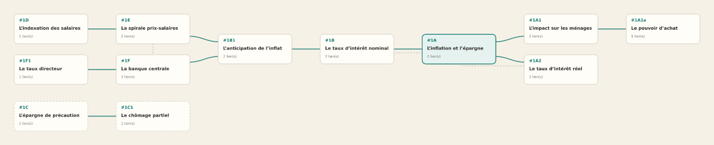
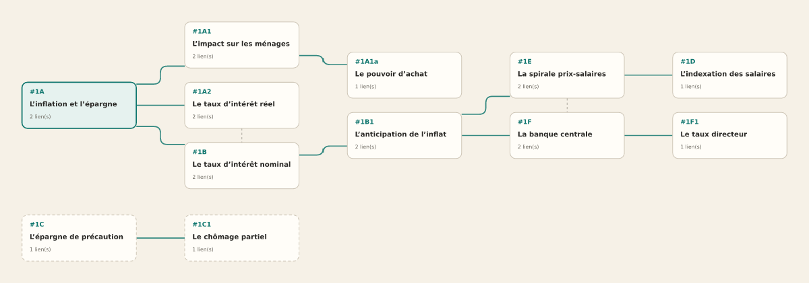
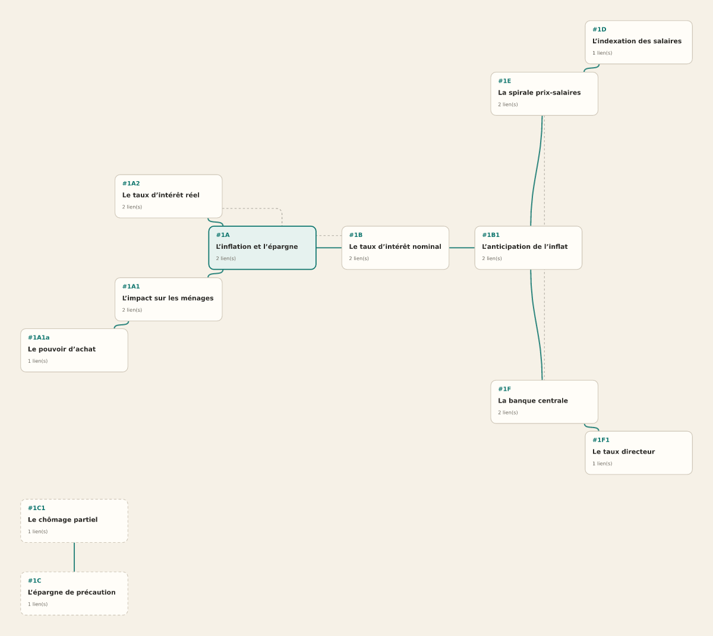
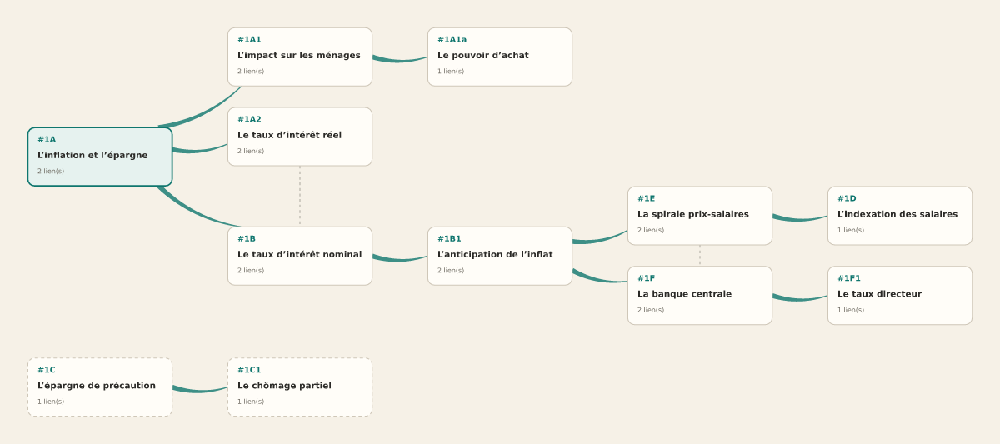
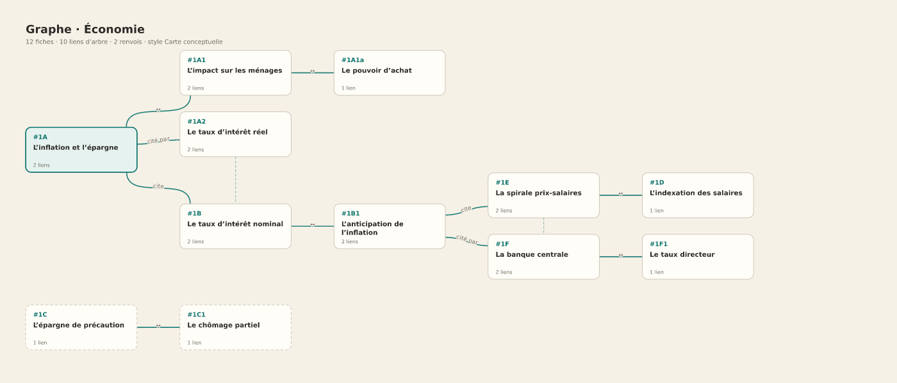

# Graphes — styles, arêtes flottantes, et la vue Zettelkasten

> Ce document répond à trois questions, dans l’ordre où elles se posent :
> **qu’a-t-on pris dans React Flow ?** (et qu’a-t-on refusé, pourquoi),
> **comment un style est-il construit ?**, et **comment un coffre de fiches
> devient-il une carte lisible par défaut ?**
>
> Rien ici n’est décoratif : chaque affirmation renvoie à un fichier ou à un
> test.

---

## 1. Fil de fer de la page « Graphe »

Écran d’un coffre (`/vault/:id/graph`), seuil bureau 1024 px. Le canevas prend
toute la hauteur ; aucune colonne latérale, parce qu’un graphe se lit en largeur
et qu’une colonne le rétrécirait.

```
┌───────────────┬────────────────────────────────────────────────────────────┐
│ É Engram  ☾   │  ← Graphe · Économie   [✦ Style] [☰ Affichage] [⑂ Racine]   │
│               ├────────────────────────────────────────────────────────────┤
│ Notes         │  12 fiches · 10 liens d’arbre · 2 renvois   ─ arbre ⇢ renvoi│
│ Projets       │                                                            │
│ Coffres   ▪   │        ┌──────────┐            ┌──────────┐                │
│ Réviser       │        │ #1A1     │            │ #1A1a    │                │
│ Apprendre     │        └────┬─────┘            └────┬─────┘                │
│               │             │  (arêtes flottantes)  │                      │
│               │        ┌────┴──────────────────────┴─────┐               │
│               │        │ #1A  · racine                    │               │
│               │        └────┬──────────────────────┬─────┘               │
│               │      ┌──────┴──────┐        ┌──────┴──────┐              │
│               │      │ #1B         │        │ #1A2        │              │
│               │      └─────────────┘        └─────────────┘              │
│               │                                                           │
│  Réglages     │   [⊞ mini-carte]                        [⌖] [＋][－]       │
│               ├────────────────────────────────────────────────────────────┤
│               │        [ Recentrer ]  [ Ouvrir la fiche ]                 │
└───────────────┴────────────────────────────────────────────────────────────┘
```

**Mobile** : même structure, sans mini-carte ni contrôles de zoom (pincement),
boutons d’en-tête réduits à deux icônes (`✦`, `⑂`), dock de deux boutons.

Choix de mise en page :

| Décision | Raison |
|---|---|
| Canevas plein cadre, pas de colonne | un graphe se lit en largeur |
| Bandeau d’état (fiches / liens / renvois) en haut, une ligne | on doit savoir ce qu’on regarde sans ouvrir de panneau |
| Styles et Racine en en-tête | ce sont deux réglages *de lecture*, pas des actions de contenu |
| `Recentrer` à gauche, `Ouvrir la fiche` à droite | l’action destructrice n’existe pas ici ; la plus fréquente est à droite sous le pouce |
| Pas de barre latérale de fiches | la liste existe déjà dans le coffre ; dupliquer aurait doublé les noms accessibles |

---

## 2. Ce qui a été pris dans React Flow — et ce qui a été refusé

### 2.1 Le balayage

Liste **complète** des 66 exemples du dépôt `xyflow/xyflow`
(`examples/react/src/examples`), obtenue par l’API GitHub le 2025-10-27 :

```
A11y · AddNodeOnEdgeDrop · Backgrounds · Basic · BrokenNodes · CancelConnection ·
ClickDistance · ColorMode · ControlledUncontrolled · ControlledViewport ·
CustomConnectionLine · CustomMiniMapNode · CustomNode · DefaultEdgeOverwrite ·
DefaultNodeOverwrite · DefaultNodes · DetachedHandle · DevTools · DragHandle ·
DragNDrop · EasyConnect · EdgeRenderer · EdgeRouting · EdgeToolbar · EdgeTypes ·
Edges · Empty · Figma · FloatingEdges · Hidden · Interaction ·
InteractiveMinimap · Intersection · Layouting · Middlewares · MovingHandles ·
MultiFlows · MultiSetNodes · NodeResizer · NodeSelectionBug · NodeToolbar ·
NodeTypeChange · NodeTypesObjectChange · Overview · Provider · Redux ·
ReconnectEdge · Remount · SaveRestore · SetNodesBatching · Stress · Subflow ·
Switch · TouchDevice · Undirectional · UpdateNode · UseConnection ·
UseKeyPress · UseNodeConnections · UseNodesData · UseNodesInit ·
UseOnSelectionChange · UseReactFlow · UseUpdateNodeInternals · Validation ·
ZIndexMode
```

**19 dossiers ont été téléchargés et lus** (code source, pas seulement les
titres) : `FloatingEdges`, `EdgeRouting`, `EdgeTypes`, `CustomNode`,
`NodeToolbar`, `DragHandle`, `AddNodeOnEdgeDrop`, `EasyConnect`, `EdgeToolbar`,
`Validation`, `Undirectional`, `Layouting`, `Subflow`, `Backgrounds`,
`DefaultEdgeOverwrite`, `CustomConnectionLine`, `ReconnectEdge`, `NodeResizer`,
`UseNodeConnections`.

### 2.2 Ce qui a été adopté

| Exemple lu | Idée retenue | Où elle vit |
|---|---|---|
| `FloatingEdges/utils.ts` | point d’accroche = intersection de la droite des centres avec le bord | `src/lib/graph/floating.ts` (`borderPoint`) |
| `FloatingEdges/FloatingEdge.tsx` | Bézier cubique à tangentes perpendiculaires au côté | `floatingCurve` + `FloatingEdge` |
| `EdgeTypes` | la famille `default` / `step` / `smoothstep` / `straight` / `simplebezier` est un **vocabulaire de lecture**, pas un détail | styles `Flux`, `Circuit`, `Direct`, `Pointillé` |
| `EdgeRouting` | le côté de sortie dépend du voisin, pas du nœud | `sidesFor` (carte mentale) et `floatingParams` (fiches) |
| `Backgrounds` | variante + pas + taille sont trois réglages distincts (points / lignes / croix) | champ `background` des styles |
| `DefaultEdgeOverwrite` | on peut changer le trait par défaut sans toucher aux nœuds | style `Pointillé` (tirets) |
| `Layouting` (dagre) | l’idée qu’une disposition est un calcul, pas des coordonnées écrites à la main | déjà en place via `src/lib/mindmap/layout.ts` |

### 2.3 Ce qui a été refusé — et pourquoi

| Exemple(s) | Verdict | Raison |
|---|---|---|
| `Layouting` (dagre), `Middlewares` | **refusé** | ajouter `dagre` (~50 ko) pour retrouver la disposition que `layout.ts` calcule déjà serait une dette, pas une fonctionnalité |
| `AddNodeOnEdgeDrop`, `EasyConnect`, `ReconnectEdge`, `Validation`, `UseNodeConnections`, `EdgeToolbar`, `NodeResizer`, `DragHandle` | **refusé (pour l’instant)** | ce sont des outils de **construction** de graphe (poignées visibles, création de liens au glisser). Notre contenu vient des fiches, pas d’un éditeur de schéma ; les poignées sont donc masquées et les arêtes calculées. À reprendre le jour où l’on éditera les liens à la main. |
| `NodeToolbar`, `CustomNode` | **partiellement** | l’idée d’actions au survol d’un nœud est gardée (survol accentué) ; la barre flottante n’a pas été reprise, elle dupliquerait le dock mobile |
| `Subflow`, `MultiFlows`, `Provider`, `MultiSetNodes`, `SetNodesBatching` | **refusé** | concernent plusieurs canevas ou de gros volumes ; nous avons un canevas par écran |
| `Redux`, `SaveRestore`, `Remount`, `ControlledUncontrolled` | **refusé** | zustand + `persist` couvrent déjà l’état et la sauvegarde |
| `Figma`, `Stress`, `BrokenNodes`, `NodeSelectionBug`, `Intersection` | **refusé** | démos de performance ou de robustesse de la lib, pas des motifs d’interface |
| `A11y`, `TouchDevice`, `Interaction`, `DevTools`, `ColorMode`, `ZIndexMode` | **partiellement** | l’accessibilité passe par nos `aria-label` et le clavier produit ; le mode couleur est géré par nos palettes ; les autres sont des outils de développement |

### 2.4 Un défaut trouvé dans l’exemple officiel

`FloatingEdges/utils.ts` calcule l’intersection côté cible avec **la largeur du
nœud source** :

```ts
const w = (intersectionNodeWidth ?? 0) / 2;
const x1 = targetPosition.x + w;   // ← largeur de la SOURCE, appliquée à la cible
```

Sur la démo, tous les nœuds font la même taille, donc le bug est invisible. Avec
une racine de 112 px et des cartes de 208 × 84, l’arête sort de la carte. Notre
version prend deux rectangles indépendants, et un test le vérifie
(`floating.test.ts` → « utilise la largeur de CHAQUE boîte »).

---

## 3. Les treize styles

Un style décrit **la présentation** ; un modèle de carte mentale décrit **la
pensée**. Les deux sont orthogonaux : 20 modèles × 13 styles, sans écrire 260
objets.

| Style | Disposition | Liens | Fond | Ce qu’il sert |
|---|---|---|---|---|
| **Arbre binaire** (défaut) | racine au centre, moitiés en miroir | flottants | points | relire un coffre comme un plan |
| **Carte conceptuelle** | arbre horizontal | flottants **étiquetés** | points | nommer chaque relation (voir `VISUALFLOW.md`) |
| Souffle | arbre horizontal | flottants | points | dérouler une thèse |
| Réseau | radial | flottants | croix | montrer un voisinage |
| Flux | arbre horizontal | angles arrondis + flèches | lignes | enchaînement, pas hiérarchie |
| Circuit | arbre horizontal | angles + flèches | points | diagramme technique |
| Direct | arbre vertical | segments + flèches | aucun | balayage rapide |
| Plume | arbre horizontal | rubans effilés | points | carte « calligraphiée » |
| Pointillé | arbre horizontal | courbes en tirets | aucun | graphe de renvois |
| Colonnes | colonnes | angles | lignes | comparer des familles |
| Frise | frise | segments | points | chronologie de fiches |
| Constellation | radial | segments fins | croix | 40 nœuds sans bruit |
| Encre | arbre vertical | rubans effilés | aucun | lecture de haut en bas |

### À quoi ça ressemble

Les quatre images ci-dessous sont **calculées par le code de production** (mêmes
fonctions `floatingCurve`, `stepPath`, `ribbonPath`, même disposition), rendues
en SVG puis rastérisées pour la documentation. Jeu de démonstration : le coffre
« Économie », 12 fiches.

| Arbre binaire (défaut) | Colonnes |
|---|---|
|  |  |

| Radial | Plume |
|---|---|
|  |  |

| Carte conceptuelle — les liens portent leur relation |
|---|
|  |

L’aperçu de chaque style est **calculé** (`graphStylePreview`) avec les mêmes
fonctions que le canevas : `floatingCurve`, `stepPath`, `ribbonPath`. Un style
ne peut donc pas mentir sur son rendu. Ce n’est pas une capture d’écran : c’est
une silhouette à sept nœuds, à l’échelle réduite.

### Où l’on choisit un style

| Écran | Entrée | Mémorisation |
|---|---|---|
| Graphe d’un coffre | bouton `✦ Style` (en-tête) | `settings.graphStyle`, donc **tous** les coffres |
| Carte mentale | bouton `✦ Style` (en-tête) ou le bouton de style du dock | `mindmap.styleId`, donc **cette carte** |

Réglage par défaut du produit : `arbre-binaire`. Une application neuve ouvre
donc chaque graphe Zettelkasten en arbre lisible, sans geste.

---

## 4. La vue Zettelkasten par défaut

### 4.1 Le problème

Un coffre est un réseau : chaque fiche cite d’autres fiches par code
(`refs: ["#1A", "#1B"]`). Dessiner tous les liens à plat donne une pelote — la
plupart des outils le font et le résultat est inutilisable à douze fiches.
L’ancien écran contournait le problème en n’affichant que deux voisins, ce qui
perdait l’essentiel.

### 4.2 Ce qui est calculé (`src/lib/graph/zettel.ts`)

1. **Liens** — paires dédupliquées, sans auto-référence ni code inconnu ;
   `mutual` indique une citation réciproque.
2. **Racine** — la fiche la plus citée (entrants + sortants) ; à égalité, le
   code le plus petit, c’est-à-dire la première écrite. Une fiche ouverte par
   `?card=`, ou choisie dans `Voir depuis…`, prend la main.
3. **Arbre** — parcours en largeur, voisins triés par ordre naturel des codes.
   Résultat **déterministe** : le même coffre donne le même dessin quel que soit
   l’ordre de stockage.
4. **Composantes déconnectées** — chaque paquet de fiches non atteintes est
   traité comme un arbre séparé, posé sous le premier, et marqué « hors arbre »
   (bordure pointillée). Aucune fiche n’est perdue.
5. **Renvois** — les liens qui ne sont pas dans l’arbre restent dessinés, plus
   fins et en tirets. C’est la lecture « structure + références croisées ».
6. **Disposition** — l’arbre est converti en modèle et rangé par le moteur
   existant (`src/lib/mindmap/layout.ts`), puis remis à l’échelle des cartes de
   208 × 84 px.

### 4.3 L’arbre binaire

La racine au centre, les enfants coupés en deux moitiés : la première à droite,
la seconde à gauche **en miroir**. C’est la seule disposition qui reste lisible
quand une racine a huit enfants directs (l’arbre horizontal classique devient
une colonne de 8 cartes de haut).

### 4.4 Ce que les tests garantissent

`src/lib/graph/zettel.test.ts` :

- ordre naturel des codes (`#1A < #1A1 < #1A1a < #1B < #2`) ;
- liens dédupliqués, réciproques repérées, codes inconnus ignorés ;
- **toutes** les fiches placées, y compris les isolées ;
- dessin identique après inversion de la liste d’entrée ;
- **aucun chevauchement** pour les six dispositions et les douze fiches du jeu
  de démonstration ;
- toutes les cartes dans les bornes annoncées ;
- la racine est bien au centre de l’arbre binaire, avec des fiches à gauche ET
  à droite ;
- une fiche « hors arbre » n’est jamais couronnée racine.

`src/lib/graph/floating.test.ts` : 8 cas de géométrie, dont boîtes de tailles
différentes, déplacement purement vertical, et boîtes confondues (aucun `NaN`).

`src/lib/graph/styles.test.ts` : 13 styles, 5 familles de liens, 6 dispositions,
vignettes finies et contenues dans leur cadre.

`src/test/smoke.test.tsx` : le graphe d’un coffre affiche **autant de nœuds que
de fiches** (12 dans la démo, pas 2) ; changer de style le mémorise ; changer de
racine re-root l’arbre ; appliquer un style à une carte mentale ne change aucun
texte.

---

## 5. Ajouter un style

1. Lire `src/lib/graph/styles.ts` — un style est un objet de sept champs.
2. Choisir une disposition existante (`tree-lr`, `tree-tb`, `tree-both`,
   `radial`, `columns`, `timeline`) et une famille de liens (`floating`,
   `bezier`, `smoothstep`, `straight`, `tapered`).
3. Renseigner `origin` : d’où vient l’idée. Un style sans provenance est un
   caprice.
4. `vitest run src/lib/graph` — la vignette doit être finie, et si la
   disposition est nouvelle, le test de chevauchement doit passer sur les douze
   fiches de démonstration.

Une **nouvelle disposition** demande en plus un constructeur dans
`src/lib/mindmap/layout.ts` (et son test de collision) — c’est le seul endroit
qui place des nœuds.

---

## 6. Limites assumées

| Limite | Pourquoi c’est acceptable ici | Ce qu’il faudrait pour lever |
|---|---|---|
| Pas d’édition de liens sur le canevas | les liens viennent des fiches (`refs`), pas d’un éditeur de schéma | reprendre `EasyConnect` + `EdgeToolbar` : poignées visibles, création au glisser |
| Positions déplacées à la main non enregistrées (graphe de coffre) | le graphe est une **vue** du coffre ; la source de vérité reste les fiches | persister un décalage par fiche, ou une position par (coffre, code) |
| Une fiche par code dans un coffre | le code est la clé de citation entre fiches | autoriser des codes dupliqués demanderait un identifiant de lien distinct |
| Pas d’animation de transition entre dispositions | le canevas se replace d’un coup et `fitView` recadre | interpolation des positions (200 ms) entre deux styles |
| Sur téléphone, un arbre large demande de paner | le dézoom initial est plafonné (0,42) pour garder les titres lisibles ; « Recentrer » recadre | une disposition mobile dédiée (une colonne par niveau, largeur 100 %) |
| La racine imposée n’est pas mémorisée | c’est une intention de lecture ponctuelle | la stocker dans les préférences de la surface |

---

## 6. Affichage, étiquettes de relation, export

Trois réglages (`settings.graphLabels`, `graphEchoes`, `graphAnimate`) et trois
gestes (SVG clair, SVG sombre, JSON) vivent dans une seule feuille, ouverte par
`☰ Affichage` :

| Réglage | Ce qu’il change | Ce qu’il ne change pas |
|---|---|---|
| **Étiquettes de relation** | un texte sur le lien : `cite`, `cité par`, `réciproque`, `lien` | aucune référence n’est ajoutée ni retirée |
| **Renvois** | affiche ou masque les liens hors arbre | les fiches restent, l’arbre reste |
| **Animation du courant** | un flux parcourt les pointillés | rien ne bouge si le mouvement est réduit |

**Pourquoi des étiquettes déduites.** Le libellé n’est pas stocké : il est
**calculé** à partir des `refs` des fiches (`src/lib/graph/labels.ts`). Un lien
d’arbre sans citation déclarée s’appelle donc « lien », pas « cite » — c’est la
seule formulation honnête. Les styles qui reposent sur les liens nommés
(`carte-conceptuelle`) allument les étiquettes quand on les choisit ; les autres
les laissent éteintes, et l’utilisateur tranche ensuite.

**Export.** `graphToSvg` réutilise `floatingCurve`, `stepPath` et `ribbonPath` :
le fichier est le dessin de l’écran, à la police près. `graphToDocument` écrit un
JSON `{ format: "engram-graphe", version: 1, … }` et `parseGraphDocument` le
relit en refusant : JSON invalide, mauvais format, fiche sans code ni titre, code
en double, lien vers une fiche absente. Un fichier accepté peut devenir un coffre
entier (fiches, codes d’origine et références) depuis la même feuille.

Tests : `src/lib/graph/labels.test.ts` (5) et `src/lib/graph/export.test.ts` (9).

**D’où vient cette partie** : VisualFlow, `Flow_renderer_test` — voir
[`VISUALFLOW.md`](VISUALFLOW.md), qui liste les 24 exemples relevés, ce qui a été
gardé, et ce qui a été refusé.
